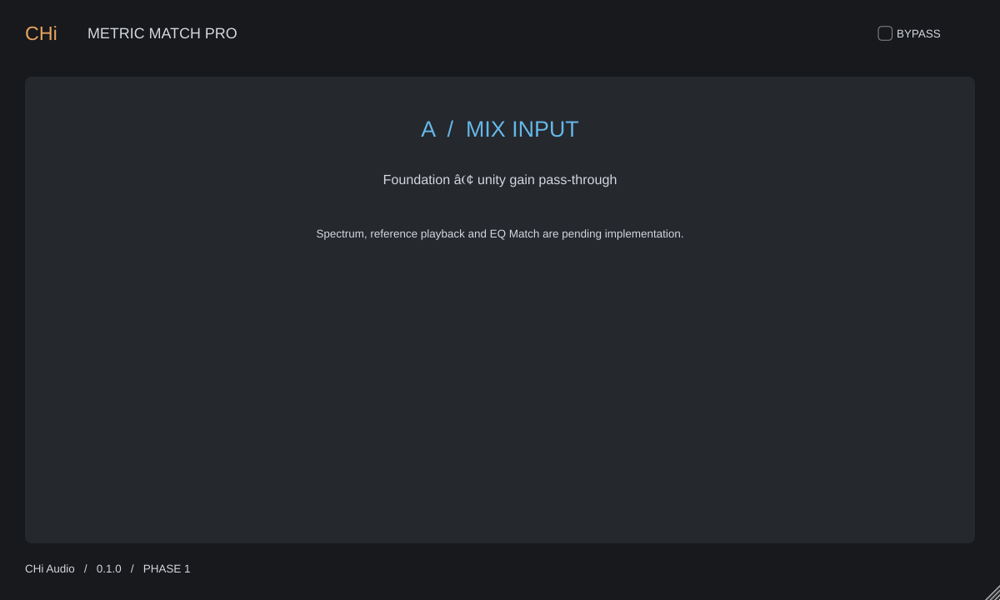

# CHi Metric Match Pro

Implementação original de CHi Audio, com referência funcional no ADPTR Metric AB.

## Auditoria: somente Fase 1

**A imagem conceitual criada na conversa não é a interface compilada. O único comando de automação implementado é Bypass. Consulte [AUDIT.md](docs/AUDIT.md) antes de baixar.**

## Estado: Fase 1

Fundação C++20/JUCE 8.0.12: plugin VST3 mono/estéreo, passagem de áudio em ganho unitário, parâmetro de bypass automatizável, serialização APVTS e editor vetorial redimensionável de 1200 × 720. Como ainda não há processamento, áudio ativo e bypass são idênticos. Nenhum controle de recurso futuro é apresentado como funcional.

Ainda **não** implementados: A/B com arquivos, FFT, EQ Match, loudness, correlação, imagem estéreo, dinâmica e biblioteca. Não é ainda um substituto funcional do Metric AB. O próximo marco é a Fase 2 do briefing.

## Estrutura

- `Source/PluginProcessor.*`: buses, áudio, bypass e estado.
- `Source/PluginEditor.*`: interface original e controle de bypass.
- `Tests/DSPTests.cpp`: áudio e persistência de estado.
- `scripts/build-windows.ps1`: build, testes e instalação opcional.

## Windows 11 / Visual Studio 2022

Instale Visual Studio 2022 com Desktop development with C++, Windows SDK, CMake ≥3.22 e Git. Em PowerShell:

```powershell
./scripts/build-windows.ps1 -Configuration Release
./scripts/build-windows.ps1 -Configuration Debug
```

O script baixa JUCE pelo CMake, compila x64 e executa CTest. Artefato: `build-windows/CHiMetricMatchPro_artefacts/Release/VST3/CHi Metric Match Pro.vst3`.

Use `-Install` somente para solicitar instalação explícita. O script pede confirmação e não sobrescreve um plugin existente. Abra um PowerShell com permissões apropriadas se a pasta Common Files exigir administrador. A instalação não é feita automaticamente.

## Linux

Requer compilador C++20, CMake, Ninja, pkg-config, desenvolvimento ALSA, FreeType, Fontconfig e X11. Com dependências disponíveis:

```sh
cmake -S . -B build-release -G Ninja -DCMAKE_BUILD_TYPE=Release -DBUILD_TESTING=ON
cmake --build build-release --parallel 2
ctest --test-dir build-release --output-on-failure
```

Para reutilizar um checkout local de JUCE, adicione `-DFETCHCONTENT_SOURCE_DIR_JUCE=/caminho/JUCE`. Repita com `build-debug` e `Debug`.

Neste executor de nuvem, as dependências foram extraídas localmente em `/workspace/tools/sysroot`, sem instalação no sistema. Use `./scripts/build-cloud.sh Release` ou `./scripts/build-cloud.sh Debug`; esse auxiliar exige o checkout JUCE em `/workspace/deps/JUCE` e o ambiente Python de ferramentas em `/workspace/tools/build`. O procedimento Linux genérico acima serve para outras máquinas com dependências instaladas.

## Validação e limites

Os testes verificam preservação exata de silêncio, impulso, senoide de 1 kHz e estéreo invertido em 5 sample rates, buffers 32/2048, mono/estéreo e bypass ativo/inativo (160 casos), além de 20 restaurações de estado e entrada de estado inválida. Há também testes de mapeamento bidirecional GUI/host, gestos de automação, 50 ciclos de editor/redimensionamento, independência entre instâncias, callbacks de bypass do host e mudanças de sample rate. `CHiTests --inventory` imprime o inventário real de parâmetros em JSON.

Não substituem testes de integração em DAW ou stress de longa duração. O pipeline Windows executa pluginval 1.0.4 nível 5 antes de publicar.

A compilação Windows é verificada no workflow; Studio One 8 e REAPER 7 ainda exigem testes nas respectivas DAWs. Um build Linux não gera um VST3 Windows.

## Uso inicial

Insira como efeito em uma faixa mono ou estéreo. A saída preserva a entrada. BYPASS é automatizável e salvo com a sessão. Nenhum áudio de referência é carregado nesta fase.

## Licenciamento

JUCE possui termos AGPLv3/comerciais próprios; revise `JUCE/LICENSE.md` antes de distribuir. A ausência de dependências comerciais obrigatórias não implica autorização para distribuir um produto fechado sem atender à licença JUCE. Nenhum código, marca ou asset proprietário da ADPTR é incluído.

## Download Windows

O workflow [Windows VST3](https://github.com/aulamix001/METRIC-EQ/actions/workflows/windows-vst3.yml) compila Release e Debug no Windows Server 2022 x64, executa os testes e publica uma pré-release somente após validar o pacote. Consulte as [Releases](https://github.com/aulamix001/METRIC-EQ/releases) e a conclusão do workflow: a presença deste texto não confirma que um build remoto já terminou.

Baixe `CHi-Metric-Match-Pro-Windows-x64.zip` e `SHA256SUMS.txt` da mesma release. Compare `Get-FileHash .\CHi-Metric-Match-Pro-Windows-x64.zip -Algorithm SHA256` com o hash publicado. Extraia o ZIP e copie a pasta completa `CHi Metric Match Pro.vst3` para `C:\Program Files\Common Files\VST3\CHi Audio\`, sem substituir versões existentes. O binário não é assinado. A funcionalidade entregue ainda é a Fase 1.

O pipeline inclui `AUDIT.md`, `BUILD-INFO.json`, testa o ZIP e baixa o pacote publicado para comparar seu SHA256. A branch [windows-downloads](https://github.com/aulamix001/METRIC-EQ/tree/windows-downloads) oferece o download mesmo quando GitHub Releases estiver indisponível. Isso verifica a integridade naquela execução; não garante disponibilidade futura do GitHub ou compatibilidade com todas as DAWs.

## Interface atual

Renderização do editor JUCE real em Linux; não é uma captura dentro do Studio One.


