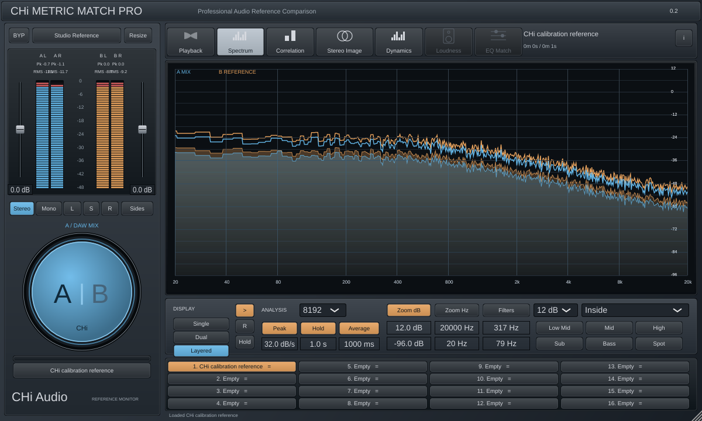

# CHi Metric Match Pro 0.2.0

Comparador de referências de áudio em C++20/JUCE 8, com interface real redesenhada a partir da proposta aprovada. Este projeto usa implementação original e identidade CHi Audio.



A imagem acima é renderizada pelo editor compilado, alimentado com sinais de calibração reais do teste. Não é a proposta gerada por IA. Em uma sessão sem áudio, os medidores e espectros ficam vazios.

## O que funciona nesta versão

- Interface HiDPI redimensionável: painel de medição A/B, faders, botão circular, abas e 16 slots de referência em quatro colunas.
- Carregamento assíncrono de WAV/AIFF/FLAC em RAM; arquivos mono/estéreo. Caminhos e quatro cues por referência salvos no estado.
- Monitoração exclusiva A (mix da DAW) ou B (referência), com crossfade de 10 ms. B continua sendo analisado ao ouvir A.
- Play/Pause, Rewind, loop da faixa completa e modos Manual/Latch/Cue/Sync básico. Shift+clique seleciona referência mantendo A. Clique no nome ativo alterna A/B.
- Ganhos A/B de ±18 dB, com suavização. Duplo clique nos faders restaura 0 dB.
- Stereo, Mono, Left, Right, Sides e Solo In Place.
- Filtros de monitoração abaixo/dentro/acima da faixa, 12/24/36/48 dB por oitava, presets e edição Spot no gráfico. Zoom dB/Hz ajustável.
- FFT Hann 2048–32768, magnitude calibrada em dBFS, média temporal, peak hold, freeze e views Single/Dual/Layered independentes por página.
- Correlação por frequência, balanço estéreo por frequência e histórico de **crest factor Peak/RMS**. Esta versão não chama crest factor de PSR.
- 37 parâmetros de automação, estado APVTS e identificação dos controles para o host.
- VST3 e adaptador independente compatível com VST2.4, baseado em header de interoperabilidade BSD. São binários diferentes, não arquivos renomeados.

## Limitações explícitas

LUFS/True Peak/PSR e EQ Match ainda não estão implementados; suas abas ficam desabilitadas. Também pendentes: disk streaming, ganhos individuais por referência, loop com limites editáveis, PDC, offsets Sync globais, compact UI, arquivo de presets e assistente de arquivos ausentes completo. Não é ainda uma reprodução integral do manual.

Referências usam orçamento total de RAM de 256 MB por instância, incluindo versões substituídas, retidas até o fechamento para evitar liberar memória na thread de áudio. Ao atingir o limite, o carregamento é rejeitado com mensagem. Use trechos de referência ou reabra a instância para liberar esse orçamento. Não há leitura de disco, FFT, alocação ou mutex de biblioteca no callback de áudio.

O VST3 aceita mono e estéreo. O adaptador VST2 usa duas entradas e duas saídas e não declara processamento double. Studio One/REAPER não foram usados neste executor; pluginval é uma validação distinta.

## Downloads e instalação no Windows

Downloads verificados da **0.2.0**, Windows x64:

- [Baixar VST3](https://raw.githubusercontent.com/aulamix001/METRIC-EQ/6461815e6c684b74d5bc6d4115f3e3282339db53/CHi-Metric-Match-Pro-VST3-Windows-x64.zip)
- [Baixar VST2](https://raw.githubusercontent.com/aulamix001/METRIC-EQ/6461815e6c684b74d5bc6d4115f3e3282339db53/CHi-Metric-Match-Pro-VST2-Windows-x64.zip)
- [Baixar os dois formatos](https://raw.githubusercontent.com/aulamix001/METRIC-EQ/6461815e6c684b74d5bc6d4115f3e3282339db53/CHi-Metric-Match-Pro-Windows-x64.zip)
- [Comprovante, hashes e execução dos testes](docs/BUILD-RECEIPT.md)

Esses links usam o commit imutável da publicação conferida. Os pacotes também são publicados em [Releases](https://github.com/aulamix001/METRIC-EQ/releases) e na [branch windows-downloads](https://github.com/aulamix001/METRIC-EQ/tree/windows-downloads) somente após testes. Confira `BUILD-INFO.json`: deve indicar versão **0.2.0** e 37 parâmetros; a versão 0.1 tinha apenas Bypass e a tela de fundação.

- `CHi-Metric-Match-Pro-VST3-Windows-x64.zip`: copie a pasta completa `CHi Metric Match Pro.vst3` para sua pasta VST3.
- `CHi-Metric-Match-Pro-VST2-Windows-x64.zip`: copie `CHi Metric Match Pro.dll` para uma pasta VST2 configurada na DAW.
- `CHi-Metric-Match-Pro-Windows-x64.zip`: contém os dois formatos e documentação.

Feche a DAW antes de atualizar, preserve uma cópia da versão anterior e faça nova varredura dos plugins. A janela nova mostra **0.2** no canto superior. Não substitua um arquivo carregado por um processo em execução. Os binários não são assinados.

Use `Get-FileHash .\nome-do-pacote.zip -Algorithm SHA256` e compare com `SHA256SUMS.txt`. O pipeline valida PE x64, ZIP e download após publicação.

## Uso

1. Insira no master após os processadores da mix.
2. Arraste arquivos para os slots ou clique em um slot vazio. O menu `=` permite carregar, localizar, remover e limpar cues.
3. Em Latch, use o transporte da DAW; em Manual, use `>` para a referência. O botão circular alterna A/B.
4. Use Playback para visualizar a forma de onda e criar cues 1–4. Clique na forma de onda para seek; roda para zoom; arraste na visão geral para reposicionar.
5. Use Spectrum para comparar curvas, filtros e médias. Botão direito no gráfico alterna filtros; Alt+clique restaura a faixa inteira.
6. As medições de Peak/RMS são reais; clique nas leituras para reiniciar seus máximos. Duplo clique na escala central alterna 48/18 dB.

## Build

Windows: Visual Studio 2022 x64, CMake ≥3.22 e Git.

```powershell
./scripts/build-windows.ps1 -Configuration Release
./scripts/build-windows.ps1 -Configuration Debug
./scripts/validate-windows.ps1
./scripts/package-windows.ps1
```

CMake gera VST3 e VST2 por padrão. `-DCHI_BUILD_LEGACY=OFF` desativa o adaptador VST2. Ele não depende do SDK Steinberg: veja [origem e licença BSD](ThirdParty/LegacyABI/ORIGIN.md).

Neste executor Linux: `./scripts/build-cloud.sh Release` e `./scripts/build-cloud.sh Debug`. Os auxiliares usam JUCE em `/workspace/deps/JUCE` e ferramentas/dependências locais em `/workspace/tools`. Instalações Linux convencionais podem usar CMake/Ninja diretamente com dependências ALSA, FreeType, Fontconfig e X11.

## Validação e licenças

Veja [VALIDATION.md](VALIDATION.md) e [AUDIT.md](docs/AUDIT.md). O pipeline executa seis suítes em Release/Debug e pluginval nível 5 nos dois formatos antes de publicar. JUCE possui termos AGPLv3/comerciais próprios; a licença BSD do header legado é distribuída com o pacote e não substitui os termos JUCE. Nenhum código, marca ou recurso gráfico da ADPTR é incluído.
